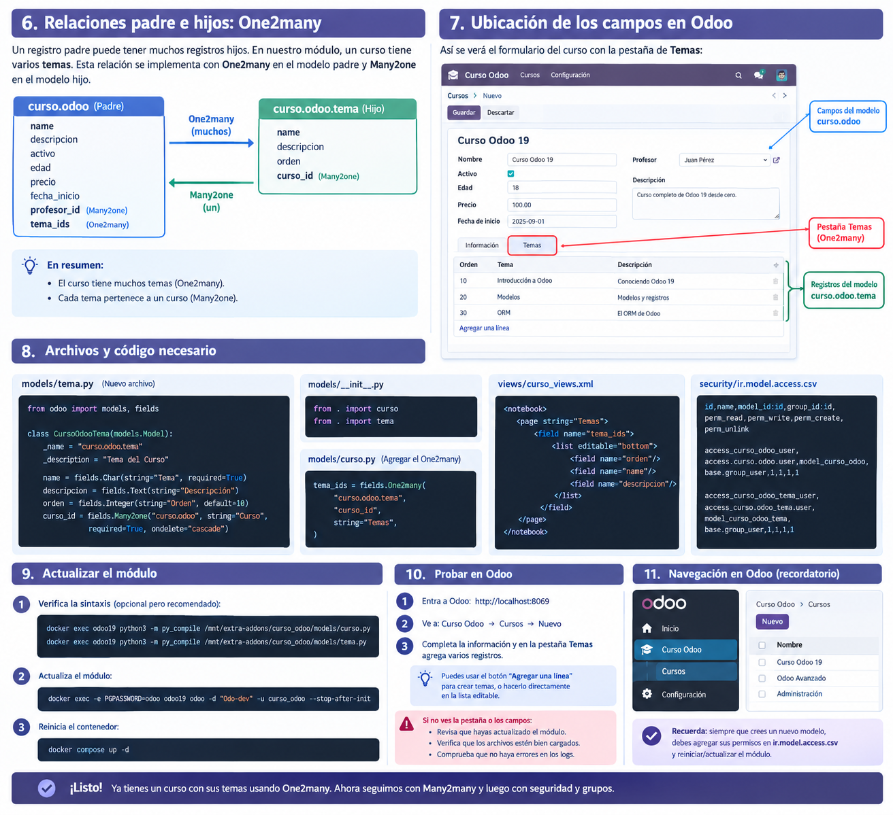

# Odoo 19 — Entorno de desarrollo

Entorno local para aprender, desarrollar y probar módulos personalizados de **Odoo 19** con Docker Compose y PostgreSQL.

**Repositorio:** <https://github.com/JuanDAvila12/odoo-dev>

> Este repositorio es un laboratorio de desarrollo. No es una configuración lista para producción.

## Estado del laboratorio

| Componente | Configuración |
|---|---|
| ERP | Odoo 19 (`odoo:19`) |
| Base de datos | PostgreSQL 15 (`postgres:15`) |
| Orquestación | Docker Compose |
| Editor recomendado | Visual Studio Code |
| Base de desarrollo utilizada | `Odo-dev` |
| Puerto web de Odoo | `8069` |
| Puerto PostgreSQL dentro de Docker | `5432` |
| Puerto PostgreSQL desde Windows | `55432` recomendado; confirmar con `docker ps` |

### Arquitectura

```text
Windows
├── Visual Studio Code
├── DBeaver / pgAdmin (cliente de PostgreSQL)
└── Docker Desktop
    ├── odoo19
    │   ├── Odoo 19
    │   ├── puerto web 8069
    │   └── /mnt/extra-addons  <── ./custom-addons
    └── odoo19-postgres
        └── PostgreSQL 15
            ├── puerto interno 5432
            └── puerto publicado local 55432 (si está configurado)
```

Odoo se conecta a PostgreSQL mediante el nombre de servicio de Compose `db` y el puerto interno `5432`. Las herramientas de Windows, como DBeaver, se conectan al puerto publicado en el host (recomendado: `55432`).

## Requisitos

- Windows 10/11
- Docker Desktop con Docker Compose v2
- Git
- Visual Studio Code
- DBeaver Community o pgAdmin 4 (opcional, para explorar PostgreSQL gráficamente)

## Estructura del proyecto

```text
odoo-dev/
├── README.md
├── .gitignore
├── docker-compose.yml
├── config/                 # Configuración opcional de Odoo
├── custom-addons/          # Módulos propios
│   └── curso_odoo/
│       ├── __init__.py
│       ├── __manifest__.py
│       ├── models/
│       ├── views/
│       └── security/
├── docs/
│   └── images/             # Diagramas e imágenes de las lecciones
└── postgres/               # Datos locales; NO se versiona
```

La carpeta `postgres/` contiene datos persistentes de PostgreSQL y debe estar excluida de Git mediante `.gitignore`. No se debe borrar para resolver errores de puertos o reinicios.

## Puertos y conexión a PostgreSQL desde Windows

El servicio `db` de `docker-compose.yml` debe publicar PostgreSQL únicamente en la interfaz local. Configuración recomendada:

```yaml
  db:
    image: postgres:15
    container_name: odoo19-postgres
    environment:
      POSTGRES_DB: postgres
      POSTGRES_USER: odoo
      POSTGRES_PASSWORD: odoo
    ports:
      - "127.0.0.1:55432:5432"
    volumes:
      - ./postgres:/var/lib/postgresql/data
    restart: unless-stopped
```

Si Windows no permite usar el puerto `55432`, seleccionar otro puerto local disponible y cambiar solamente el número de la izquierda. Por ejemplo, `127.0.0.1:PUERTO_LOCAL:5432`. El puerto interno `5432` no cambia.

Comprobar el puerto efectivo:

```powershell
docker ps
```

Debe aparecer una asignación similar a:

```text
127.0.0.1:55432->5432/tcp
```

### Parámetros para DBeaver / pgAdmin

| Campo | Valor |
|---|---|
| Motor | PostgreSQL |
| Host | `127.0.0.1` |
| Puerto | `55432` (o el puerto local realmente publicado) |
| Base de datos | `Odo-dev` |
| Usuario | `odoo` |
| Contraseña | La configurada localmente en `docker-compose.yml` |

Las credenciales simples del laboratorio son solo para desarrollo local. No reutilizarlas en un servidor ni publicar credenciales reales.

## Arranque y operación

Desde la carpeta que contiene `docker-compose.yml`:

```powershell
# Validar el Compose
docker compose config

# Iniciar servicios
docker compose up -d

# Ver contenedores y puertos
docker ps

# Ver logs de Odoo
docker logs odoo19 --tail 100

# Ver logs de PostgreSQL
docker logs odoo19-postgres --tail 100

# Reiniciar únicamente Odoo
docker compose restart odoo

# Detener y retirar contenedores/red (conserva la carpeta postgres)
docker compose down
```

**No utilizar `docker compose down -v` como comando rutinario.** Antes de cualquier operación destructiva, realizar un respaldo de la base de datos y confirmar qué se desea eliminar.

Acceso web: <http://localhost:8069>

## Módulo de práctica: `curso_odoo`

El curso utiliza un módulo propio para practicar conceptos fundamentales de Odoo.

### Modelo principal: `curso.odoo`

Campos trabajados durante las lecciones:

| Campo técnico | Tipo | Propósito |
|---|---|---|
| `name` | `Char` | Nombre del curso |
| `descripcion` | `Text` | Descripción |
| `activo` | `Boolean` | Estado activo/inactivo |
| `edad` | `Integer` | Campo entero de práctica |
| `precio` | `Float` | Campo decimal de práctica |
| `fecha_inicio` | `Date` | Fecha de inicio |
| `profesor_id` | `Many2one` | Contacto principal (`res.partner`) |
| `tema_ids` | `One2many` | Temas asociados al curso (`curso.odoo.tema`) |
| `profesores_ids` | `Many2many` | Campo de práctica para varios contactos; agregarlo al código/vista y validar antes de considerarlo terminado |

### Modelo hijo: `curso.odoo.tema`

Campos del ejercicio One2many:

- `name`: nombre del tema.
- `descripcion`: descripción.
- `orden`: orden de presentación.
- `curso_id`: relación `Many2one` al curso padre.

La relación One2many se configura en el padre con `tema_ids` y en el hijo con `curso_id`.

### Archivos importantes

- `models/curso.py`: modelo principal y campos.
- `models/tema.py`: modelo de temas, si el ejercicio One2many está incorporado.
- `models/__init__.py`: importa los archivos de modelos.
- `views/curso_views.xml`: vistas de lista/formulario, acción, menú y pestaña de temas.
- `security/ir.model.access.csv`: permisos de acceso a los modelos.
- `__manifest__.py`: metadatos, dependencias y archivos que Odoo carga.

## Actualizar el módulo personalizado

El nombre técnico del módulo es `curso_odoo` y la base de práctica es `Odo-dev`.

1. Guardar los archivos en `custom-addons/curso_odoo/`.
2. Comprobar la sintaxis de los archivos Python desde el contenedor:

```powershell
docker exec odoo19 python3 -m py_compile /mnt/extra-addons/curso_odoo/models/curso.py
docker exec odoo19 python3 -m py_compile /mnt/extra-addons/curso_odoo/models/tema.py
```

El segundo comando aplica cuando existe `models/tema.py`.

3. Actualizar el módulo:

```powershell
docker exec -e PGPASSWORD=odoo odoo19 odoo -d "Odo-dev" -u curso_odoo --stop-after-init
```

4. Volver a iniciar el servicio si quedó detenido:

```powershell
docker compose up -d
```

5. Revisar los logs si hay errores:

```powershell
docker logs odoo19 --tail 100
```

Reiniciar el contenedor por sí solo no equivale a actualizar el módulo; para que Odoo aplique cambios de modelos y XML se debe actualizar el módulo.

## Consultas SQL de aprendizaje

Con DBeaver o pgAdmin, conectado a la base `Odo-dev`, pueden inspeccionarse las tablas del módulo. Por ejemplo:

```sql
SELECT id, name, edad, precio, fecha_inicio, activo, profesor_id
FROM public.curso_odoo
ORDER BY id;
```

Para los temas, cuando el modelo hijo esté instalado:

```sql
SELECT id, curso_id, name, orden, descripcion
FROM public.curso_odoo_tema
ORDER BY curso_id, orden;
```

Se recomienda utilizar el ORM de Odoo para modificar datos de negocio. Las consultas SQL directas deben reservarse para lectura, diagnóstico y administración controlada, porque escribir directamente en tablas puede omitir lógica, validaciones y mecanismos del ORM.

## Material visual del curso

Las lecciones irán agregando diagramas y capturas en `docs/images/`. La siguiente imagen es una guía conceptual de la relación One2many y de dónde se muestra en el formulario del módulo:



> La imagen es ilustrativa. Los nombres de menús y la distribución exacta pueden variar según la versión, idioma y personalizaciones de Odoo. El código del repositorio es la referencia técnica.

## Ruta de aprendizaje

| Tema | Estado |
|---|---|
| Preparación del entorno Docker | ✅ Realizado |
| Arquitectura de Odoo | ✅ Estudiado |
| Primer módulo personalizado | ✅ Realizado |
| Modelos y campos básicos | ✅ Realizado |
| Relación Many2one | ✅ Probada |
| Relación One2many | 🧪 Ejercicio en curso / validar en el repositorio local |
| Relación Many2many | 📘 Siguiente práctica; validar antes de marcar completada |
| Grupos y permisos avanzados | ⏳ Pendiente |
| Record rules | ⏳ Pendiente |
| ORM y dominios | ⏳ Pendiente |
| Herencia de modelos y vistas | ⏳ Pendiente |
| Campos calculados y automatizaciones | ⏳ Pendiente |
| Reportes e integraciones | ⏳ Pendiente |

## Buenas prácticas de Git

Antes de subir cambios:

```powershell
git status
git diff -- README.md docker-compose.yml
```

Agregar archivos específicos y crear un commit descriptivo:

```powershell
git add README.md docker-compose.yml docs/images/
git commit -m "Actualiza documentación y acceso local a PostgreSQL"
git push origin main
```

Antes de usar `git add .`, revisar que `postgres/`, `.env`, respaldos y archivos sensibles estén excluidos. Nunca versionar la carpeta de datos PostgreSQL.

## Objetivo del proyecto

Construir una base sólida para desarrollar módulos empresariales mantenibles en Odoo 19: inventarios, compras, ventas, contabilidad, automatizaciones e integraciones, siempre mediante addons personalizados y sin modificar directamente el código fuente de Odoo.

## Autor

Juan Luis — <https://github.com/JuanDAvila12>
